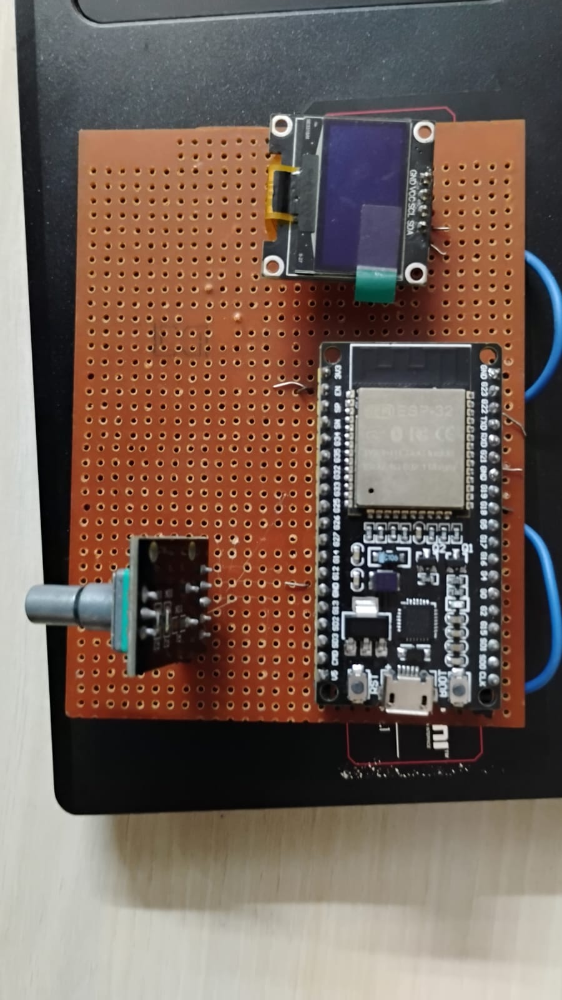

# PC monitor and control project
This project is a small desk console built using an ESP32 microcontroller. It shows a laptop's CPU usage, RAM and gpu usage and top 5 programs occupying programs using the cpu on an OLED screen. The user can switch between options with a rotary encoder and can set the laptop's volume and lock it using the encoder and the switch. A Python script runs on the laptop to collect the data and talk to the ESP32 over WiFi using simple HTTP requests. The software is written in C with ESP-IDF,  which runs on the FreeRTOS real-time operating system.

# The pages
- home page
- process page
- lock page
- volume page
- media page(work in progress)

the home page shows the cpu, ram and gpu usage. The process page shows the top 5 prpocess running on the laptop.  The lock page provides us with the option to lock the pc connected. the volume page can be used to control the volume of the pc. The media page will provide us with options to control the media playing on the pc.

# http authentication
Every request from the esp32 and the pc carries a shared token in the X-Auth-Token header. The ESP32 compares it with its stored value and replies HTTP 401 if it does not match, so other devices on the same WiFi cannot send commands.

# Future scope
- complete the media control page
- add a local AI using lamma or LM studio
- secure transport using HTTPS 
- display services running on pc such as github

# Project image
